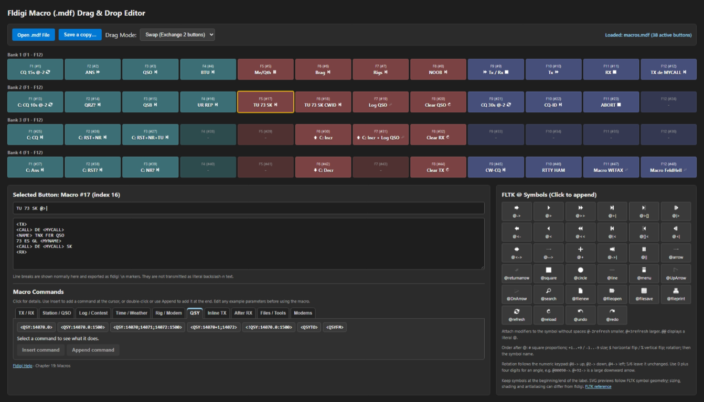

# Macro Workbench for fldigi

An independent browser editor for fldigi `.mdf` macro files. Rearrange macro buttons with drag and drop, insert commands at the cursor or append them, build UTC or local date/time tags, and preview FLTK label symbols.

1. Download `index.html` and open it in a modern browser. No installation or build is required.
2. Select **Open .mdf File**, then click a macro slot to edit its label and text.
3. Use **Save a copy** to download the result. Open that copy in fldigi when ready.

Macro files are read and exported locally in the browser. The editor does not run macro commands or control a radio; verify what a macro will do before running it in fldigi.

See the [fldigi macro manual](https://www.w1hkj.org/FldigiHelp/macros_sub_page.html) for command behavior. The editor is licensed under the [GNU Library GPL v2.0](./LICENSE); see [third-party notices](./THIRD-PARTY-NOTICES.md) for the adapted FLTK previews.
